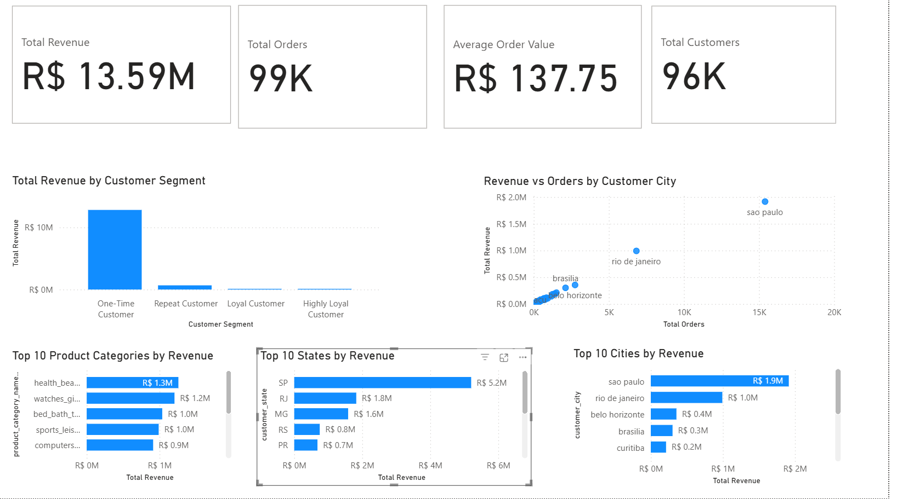

# OLIST E-Commerce Sales & Customer Analytics
Brazilian e-commerce sales, customer behaviour, and product performance analysis using Power BI.

## Project Overview
This project uses Power BI to analyse Brazilian e-commerce data from September 2016 to October 2018. The goal is to explore sales performance, customer purchasing behaviour, product category performance, and geographic revenue distribution through an interactive business intelligence dashboard.
## Dashboard Preview

## Business Objectives
- Monitor key sales performance indicators.
- Understand revenue distribution across customer purchase-frequency segments.
- Identify leading product categories, states, and cities by revenue.
- Compare customer-city order volumes with revenue.
- Translate transactional data into insights that support business decision-making.

## Tools & Technologies
- **Power BI Desktop** — dashboard development and data visualisation
- **Power Query** — data preparation and transformation
- **DAX** — measures and business calculations
- **Data modelling** — relationships between customer, order, and product tables

## Key Performance Indicators
- Total Revenue: approximately R$13.59 million
- Total Orders: approximately 99,000
- Average Order Value: approximately R$137.75
- Total Customers: approximately 96,000

*Revenue is calculated from product-item prices and excludes freight charges. KPI values are rounded as displayed in the dashboard.*

## Dashboard Pages

### 1. Executive Overview
Provides a high-level view of revenue, orders, average order value, customer counts, customer-segment revenue, and geographic and product-category performance.

### 2. Customer Analysis
Explores customer purchase-frequency segments, their contribution to revenue, and revenue per customer.

### 3. Product & Customer Performance
Examines leading customers, product categories, and cities using revenue, order counts, and revenue-per-order comparisons.

## Initial Findings
- One-time customers contribute the largest share of total product revenue.
- São Paulo is the leading city by revenue in the displayed analysis.
- Health and beauty is the highest-revenue product category among the categories displayed.
- Revenue and order volume vary substantially across cities and states.

These findings are descriptive and do not establish that customer purchase frequency causes higher spending.

## Skills Demonstrated
- Business intelligence reporting
- KPI development and DAX
- Data modelling and relationship management
- Customer segmentation
- Sales and geographic performance analysis
- Interactive dashboard design
- Communicating findings for business stakeholders

## Project Files
- Power BI report (`.pbix`) — to be added
- Dashboard screenshots — to be added

## Data Source
The project uses the Brazilian e-commerce dataset commonly known as the Olist dataset. The data covers orders purchased between September 2016 and October 2018.

## Disclaimer
This is a portfolio analytics project based on historical transactional data. Findings describe the dataset and should not be interpreted as causal conclusions or forecasts.
